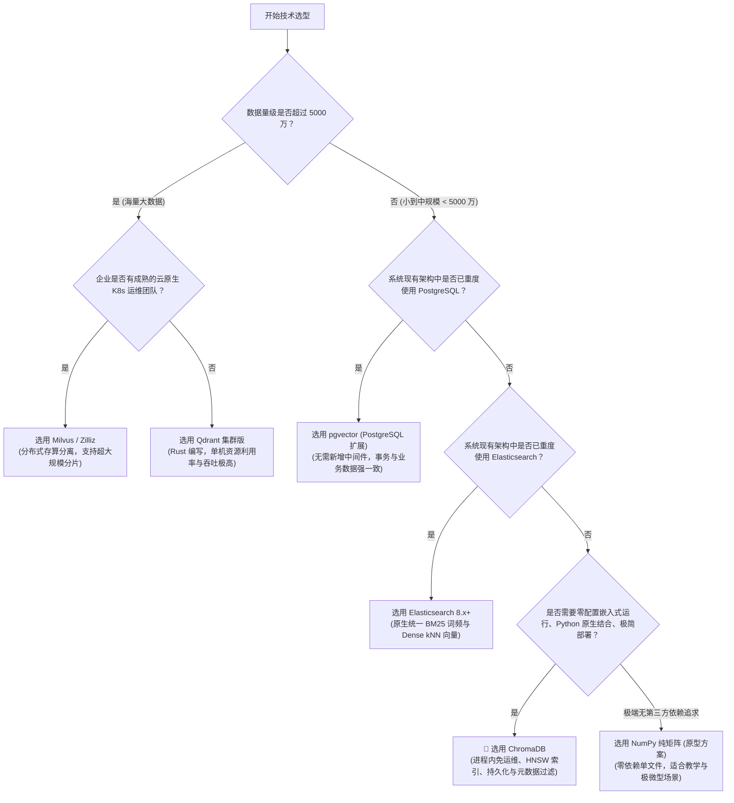

# 企业级 RAG 向量数据库选型与架构方案 (Vector Database Selection Guide)

> **版本**：v1.0.0  
> **面向场景**：智能代码审查、SQL 规范合规质检、企业私有知识库 (RAG)  
> **文档定位**：为企业级 RAG 系统落地提供科学、客观、可量化的向量存储技术选型依据。

---

## 一、 选型背景与业务场景特征分析

在构建 `sql-checker-agent` 及类似企业级 RAG 系统时，向量存储（Vector Store）是连接**离线嵌入流水线（Embedding Pipeline）**与**在线混合检索（Hybrid Retrieval）**的核心枢纽。

在做技术选型之前，首先必须对**业务场景的技术特征**建立清晰认知：

| 评估维度 | 本项目 / 企业设计规范场景特征 | 业务含义与技术约束 |
| :--- | :--- | :--- |
| **数据体量 (Data Volume)** | 小至中规模（100 ~ 100,000 切块） | 企业开发规范、制度、手册切分后通常在几百至数万切块，不需要为“十亿级海量”做过度设计。 |
| **读写特征 (R/W Ratio)** | **重度读多写少 (Read-Heavy)** | 规范文档偶尔更新（低频写），审查系统 7x24 小时高频响应 CI/CD 与研发咨询（高频读）。 |
| **查询延迟 (P99 Latency)** | **< 15ms** | 检索耗时是整个 RAG 审查流程中最不能拖后腿的一环（LLM 推理本身耗时较长）。 |
| **元数据过滤 (Metadata Filter)** | **强依赖标量过滤 (Pre-filtering)** | 需要按 `category`（如 `naming`, `ddl_rule`）、`heading_path` 等多字段进行布尔逻辑联合筛选。 |
| **持久化与自愈 (Persistence)** | **强一致性、本地可持久化、0ms 冷启动** | 服务重启或 Pod 迁移时，要求无需重新调用 Embedding 模型，秒级直接从磁盘加载可用。 |
| **部署与运维成本 (Ops Cost)** | **轻量化、极低运维负担、最好嵌入式** | 避免为了几万条向量单设笨重的分布式集群（如单独维护 ZooKeeper、Pulsar、MinIO）。 |

---

## 二、 六大主流向量数据库横向评测矩阵

当前工业界与开源社区主流的 6 类向量存储技术方案横向对比如下：

| 选型方案 | 部署架构 | 开发语言 | 索引算法 | 标量过滤性能 | 混合检索支持 | 运维成本 | 适用数据规模 | 核心优势 | 潜在瓶颈 |
| :--- | :--- | :--- | :--- | :--- | :--- | :--- | :--- | :--- | :--- |
| **ChromaDB** *(本项目选型)* | 嵌入式进程内 / 轻量服务模式 | Python / Rust | HNSW | ⭐⭐⭐⭐ 内置 SQLite 关系过滤 | 需配合上层稀疏检索 | 🟢 **极低** (零配置，一键持久化) | 10万 ~ 百万级 | Python 生态融合极好、API 简洁极简、支持磁盘原子持久化与元数据过滤 | 单机规模受限，不适合十亿级超大规模分布式分片 |
| **NumPy 原生矩阵** *(初始方案)* | 内存数组 + 磁盘 `.npy` | Python / C (BLAS) | 暴力遍历 (Flat) | ⭐⭐ 需应用层自行做掩码过滤 | 需结合外部 BM25 | 🟢 **零** (纯文件，零第三方依赖) | 1千 ~ 2万级 | 零依赖、底层 C 加速、学习成本为零、确定性 100% | 向量数量大时线性遍历耗时飙升；无内置 HNSW 索引与分词 |
| **FAISS** (Meta) | 嵌入式 C++ 算法库 | C++ / Python | IVF, HNSW, PQ 等多样化 | ⭐⭐ 默认仅纯向量，过滤需复杂封装 IDMap | 无 | 🟡 **中低** (需自研封装持久化与服务化) | 百万 ~ 千万级 | 纯算法算力天花板、显卡 GPU 加速强劲、内存压缩比极高 | 偏向算法底层，无内置持久化机制与元数据管理，工程化封装成本高 |
| **Milvus / Zilliz** | 云原生分布式集群 | Go / C++ | HNSW, DISKANN, SCaNN 等 | ⭐⭐⭐⭐⭐ 专属标量执行引擎 | 支持（Milvus 2.4+ 内置稀疏检索） | 🔴 **高** (需 ZooKeeper, MinIO, Pulsar/Kafka 等多中间件) | 千万 ~ 十亿级 | 分布式存算分离、十亿级超大规模水平扩展、企业级 SLA 与多租户安全 | 架构沉重，极占内存与容器资源，小型项目与 POC 严重过度设计 |
| **Qdrant** | 单机服务 / 分布式集群 | Rust | HNSW (支持过滤Payload索引) | ⭐⭐⭐⭐⭐ 原生 Payload 索引过滤，业界领先 | 原生支持稀疏向量混合检索 | 🟡 **中等** (单二进制部署，开箱即用) | 百万 ~ 亿级 | Rust 编写内存极省、过滤性能极强、原生支持 Sparse Vectors 混合检索 | 生态丰富度略逊于 Python 原生库，需额外维护后台守护服务 |
| **pgvector** (PostgreSQL) | 关系型数据库扩展插件 | C | IVFFlat, HNSW | ⭐⭐⭐⭐⭐ 继承完整 SQL 事务与 ACID 关联 | 原生支持 TSVector 全文检索 + 向量混合 | 🟢 **极低** (若已有 PG，零新增中间件) | 百万级 | 向量数据与业务关系数据同库，支持 ACID 事务，运维认知完全复用 | 亿级规模性能不如专用向量引擎；PostgreSQL 共享缓冲池资源竞争 |
| **Elasticsearch** (8.x+) | 分布式搜索集群 | Java | HNSW | ⭐⭐⭐⭐⭐ 工业级全文检索与过滤能力 | 原生原生 BM25 + kNN 融合 | 🔴 **高** (JVM 调优、内存开销大) | 亿级 | 搜索界绝对霸主，企业已有 ES 时可一站式统一全文检索与向量检索 | 内存占用巨大，小规模场景部署开销过重 |

---

## 三、 主流方案深度剖析与典型适用场景

### 1. ChromaDB：Python 原生与中轻量级 RAG 的第一选择
- **技术定位**：专为 LLM 应用而生的开源嵌入式向量数据库（AI-native open-source embedding database）。
- **核心优势**：
  1. **零外部中间件依赖**：可作为 Python 库直接 `import chromadb` 嵌入在 FastAPI 进程内运行，通过 `PersistentClient` 自动落地为 SQLite 与 Parquet/Bin 文件，极简便携；
  2. **内置高效 HNSW 图索引**：无需全量遍历向量点积，在对数复杂度内完成近似近邻检索；
  3. **标量与元数据过滤（Metadata Filtering）**：原生支持 `$eq`, `$in`, `$and` 等表达式，方便直接按规范类别 `category` 或适用语言进行前置过滤；
  4. **集合（Collection）天然隔离**：不同业务域（如 `mysql_rules`, `java_rules`）只需分属不同集合，结构非常清晰。
- **最佳场景**：中小型项目、企业级单个微服务、规范审核 Agent、本地开发与私有化单机部署。

### 2. pgvector：已有 PostgreSQL 企业的性价比之王
- **技术定位**：PostgreSQL 的向量扩展插件。
- **核心优势**：
  - 如果企业核心业务库本来就是 PostgreSQL，安装扩展后即可在同一张表里存储 `id`, `table_name`, `embedding (vector(2560))`；
  - 可以直接编写标准 SQL 进行向量排序：
    ```sql
    SELECT id, rule_name FROM spec_rules 
    WHERE category = 'naming' 
    ORDER BY embedding <=> '[0.012, ...]' LIMIT 5;
    ```
  - 天然享有数据库主从复制、分库分表、备份恢复与 ACID 事务保障。
- **最佳场景**：企业内部已有成熟 PostgreSQL 基础设施，不希望引入任何新数据库。

### 3. Milvus：超大规模多租户分布式平台
- **技术定位**：为千亿级海量向量搜索而生的分布式云原生向量数据库。
- **核心优势**：
  - 存算分离架构，支持 Coordinator、Worker、IndexNode 独立水平扩缩容；
  - 完备的 RBAC 权限控制、多租户隔离、数据归档机制。
- **最佳场景**：互联网大厂、企业级 AI 开放平台、汇聚全集团数亿级文档的集中式向量中台。

---

## 四、 企业级选型决策树 (Decision Tree)

在实际工程决策中，可遵循以下决策树进行选型定夺：



---

## 五、 本项目架构演进：从 NumPy 到 ChromaDB

本项目遵循 **企业级 MVC 分层架构** 与 **仓储模式（Repository Pattern）**，从 NumPy 迁移至 ChromaDB 实现了平滑演进：

### 1. 架构演进对比
| 指标 | 阶段一：NumPy 纯矩阵存储 | 阶段二：ChromaDB 向量数据库 | 提升点与架构收益 |
| :--- | :--- | :--- | :--- |
| **检索算法** | 暴力线性遍历 (Flat Brute-force) | **HNSW (分层可导航小世界图)** | 查询复杂度从 $O(N)$ 降至 $O(\log N)$，在大规模扩充规范时检索性能不衰减。 |
| **元数据过滤** | 需在内存中手工编写 Python List 推导式 | **原生 Collection Metadata 过滤** | 支持在检索底层直接下推过滤条件（Push-down filtering），避免全量计算无用向量。 |
| **数据持久化** | 自行序列化 `.npy` + `.json` 两个独立文件 | **事务级 SQLite + 统一目录持久化** | 自动维护数据一致性，彻底消除文件不一致导致的空指针风险。 |
| **集合管理** | 单个文件混杂 | **按 Collection 逻辑隔离** | 未来轻松支持多个不同数据库规范（如 `mysql_spec`, `oracle_spec`）独立分区管理。 |
| **MVC 解耦** | 仓储接口定义 | 仓储接口保持 100% 契约一致 | **上层 Service（Knowledge/Retrieval）与 Controller 无需改动一行核心业务代码**。 |

---

## 六、 总结与落地建议

1. **小步快跑，契约先行**：在 MVC 架构中，向量仓储必须遵循抽象接口（`save`, `search`, `load`, `is_empty`）。无论底层是 NumPy、ChromaDB 还是将来的 Milvus，上层编排与 LLM 审核流程应始终保持稳定不变；
2. **轻量起步，量体裁衣**：在研发规范审查、单部门知识库等典型中小型场景中，**ChromaDB 是兼顾企业级功能（HNSW、元数据过滤、持久化）与极简运维成本的最优解**；
3. **混合检索仍是关键**：向量数据库解决稠密语义召回，BM25 解决代码与技术术语精准命中。两者通过 RRF（倒数排名融合算法）互补结合，是工业级 RAG 保证 100% 规则召回的黄金搭档。
